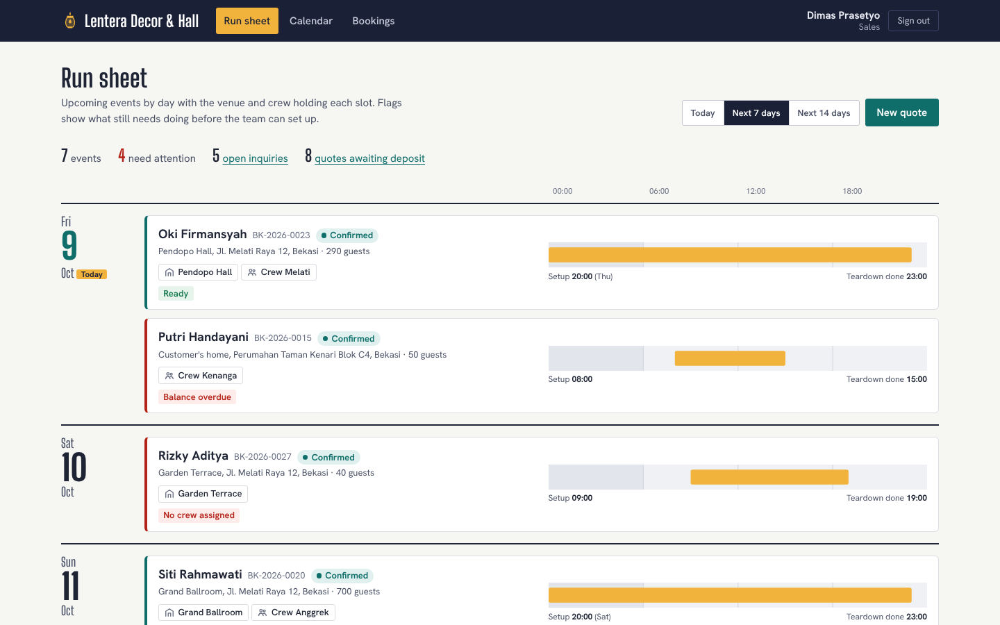
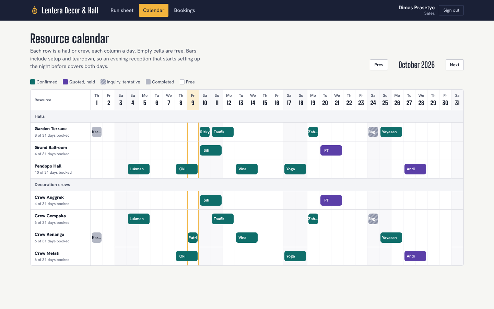
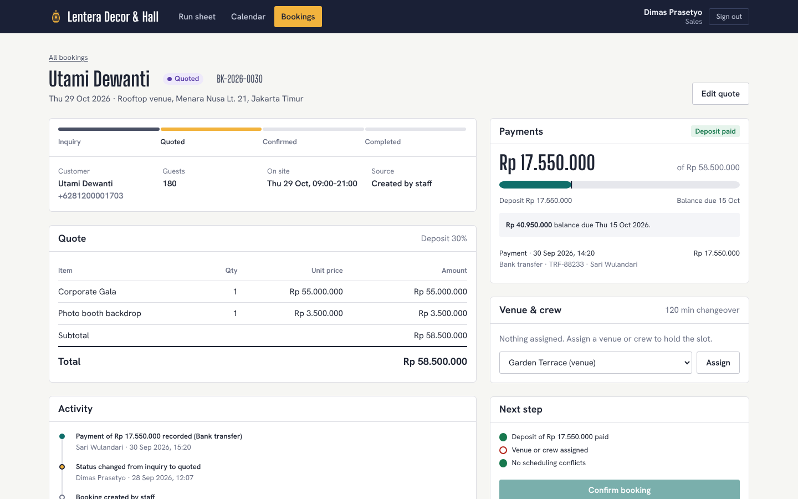
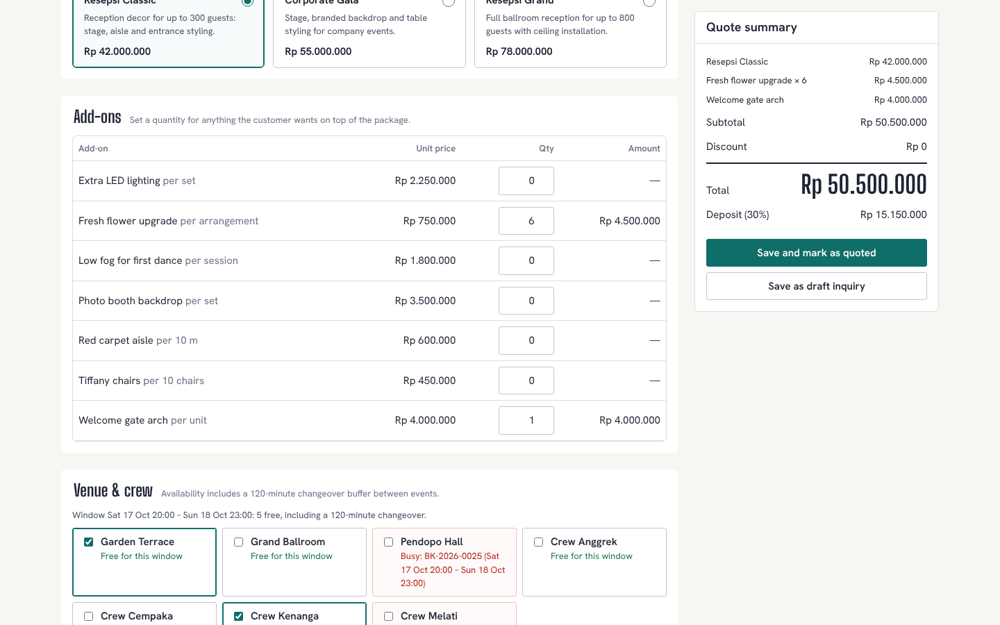
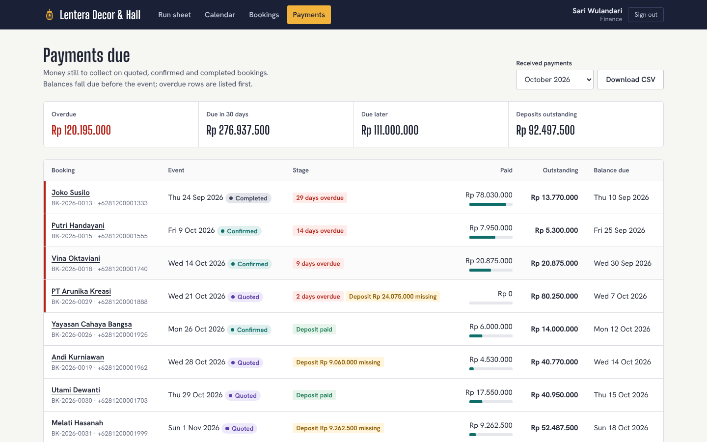
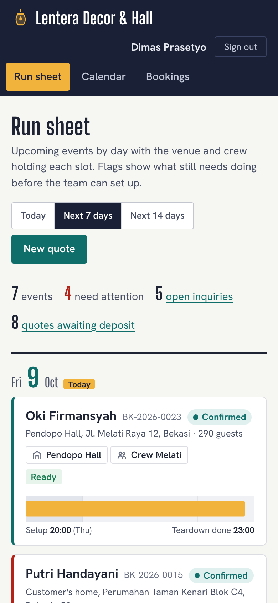
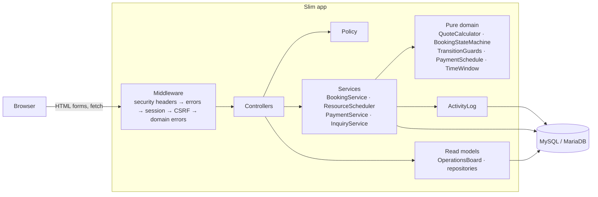
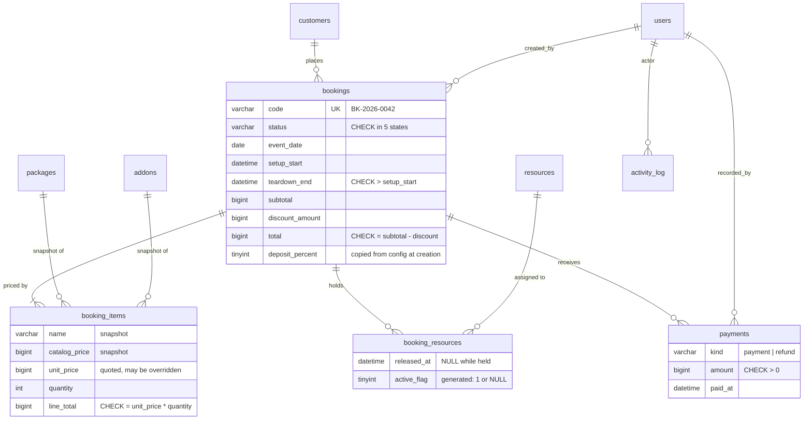

# Event Booking System

Booking and operations system for an event decoration & venue rental business: quotes, resource scheduling with conflict detection, deposits and payment tracking.

[](https://github.com/oka-adabi/event-booking-system/actions/workflows/ci.yml)

> Portfolio project. All data in this repository is fictional sample data. "Lentera Decor & Hall" is an invented business.



## The problem

A decoration and venue rental business sells the same halls and the same decoration crews again and again. Quotes go out on WhatsApp, deposits arrive by bank transfer, and a spreadsheet tracks who is where. The expensive mistakes come from that spreadsheet:

- the same hall or crew promised to two families on the same evening;
- a booking treated as "confirmed" before the deposit arrived;
- a quote that changes after a catalog price update;
- nobody noticing that a balance is overdue until the week of the event.

This application makes those mistakes hard to make. It enforces the rules in one place on the server and shows the team what still needs doing.

## Features

- **Public inquiry form** (`/inquiry`, no login). It creates a customer (matched by phone number) and a booking in `inquiry` status. Bots are filtered by a honeypot field and a database-backed rate limit per IP.
- **Quote builder.** Pick a package and add-ons. The total updates live in vanilla JS that mirrors the server calculation. Free and busy venues and crews are shown for the proposed setup→teardown window through a JSON endpoint. Ticked resources are reserved in the same transaction as the quote.
- **Price snapshots.** Each booking item stores the name, catalog price and quoted unit price at save time. Later catalog changes never reprice an existing quote. Owners can override a unit price, and the override is audited.
- **Resource scheduling with conflict detection.** A venue or crew cannot hold two bookings whose windows overlap, including a configurable changeover buffer. Cancelling a booking releases its resources.
- **Guarded state machine.** The flow is `inquiry → quoted → confirmed → completed`, and `cancelled` is reachable from any open state. To confirm, the deposit must be paid, at least one resource must be assigned and there must be no conflicts. Completing is only possible after the event. Cancelling needs a reason. A blocked transition shows a flash message that names exactly what is missing.
- **Payments.** The deposit percentage (default 30%) gates confirmation. The balance is due N days before the event (default 14). Payments and refunds are recorded with method, reference, timestamp and who recorded them. Outstanding and overdue amounts are derived, never stored.
- **Finance view.** Receivables are aged as overdue, due within 30 days, or due later. There is a monthly CSV export of received payments, guarded against spreadsheet formula injection.
- **Resource calendar.** A month grid of resources × days shows occupancy at a glance.
- **Activity log.** Status changes, payments, refunds, price overrides and resource assignments are recorded with who, when, and before/after JSON.
- **Roles.** `sales` creates quotes and schedules. `finance` records payments and refunds. `owner` can do everything, and also manages packages, add-ons, resources and staff. All rules live in one `Policy` class, and the UI only shows actions the role and the booking state allow.

| | |
|---|---|
|  |  |
|  |  |



## Tech stack

| Area | Choice |
|---|---|
| Language | PHP 8.3 (strict types, enums, readonly properties) |
| HTTP | Slim 4 + slim/psr7, manual dependency wiring in `config/container.php` |
| Views | Twig with auto-escaping and `strict_variables` |
| Database | MySQL 8 / MariaDB 10.11, plain numbered SQL migrations |
| Config & logs | vlucas/phpdotenv, Monolog |
| Front end | Hand-written CSS with design tokens, ~220 lines of vanilla JS, self-hosted fonts |
| Quality | PHPUnit 11, PHPStan level 8, PHP_CodeSniffer (PSR-12) |
| CI | GitHub Actions with a MySQL 8 service container |

## Architecture



- **Controllers** are thin. They parse input with `FormInput`/`QuoteForm`, call a service, and redirect with a flash message.
- **Services** own every write. Each public method is one transaction: lock the booking row, re-check the rules against fresh data, write, and append to the activity log.
- **The pure domain classes** have no database access, so the rules (totals, deposit rounding, overdue dates, allowed transitions) are unit tested directly.
- **`DomainErrorMiddleware`** turns `ValidationFailed` and `DomainRuleViolation` into "redirect back with a flash message and the old input" (or JSON 422 for `/api/*`). Controllers therefore contain no try/catch boilerplate.
- **Wiring.** `config/container.php` holds every service factory in one readable file. The HTTP tests build the app through the same `config/app.php`.

## Database



- **Money.** Every amount is an integer number of rupiah in a `BIGINT` column. Floats never appear in PHP, SQL or JS. The deposit rounds *up* to the next rupiah.
- **Assignment history.** `booking_resources` keeps released assignments for history. A generated `active_flag` (1 while held, NULL once released) plus `UNIQUE (booking_id, resource_id, active_flag)` acts as a partial unique index. A resource can be held only once per booking, but can be released and re-assigned later.
- **Sessions** are stored as SHA-256 hashes of the session id. **Rate-limit keys** (email+IP, IP) are stored hashed as well.
- **Migrations** are plain `.sql` files in `database/migrations/`, applied in order by `bin/migrate` and recorded in `schema_migrations`.

## HTTP endpoints

All pages are server-rendered. Every non-GET request needs the session's CSRF token (form field `_csrf` or `X-CSRF-Token` header).

| Method & path | Who | Purpose |
|---|---|---|
| `GET /health` | public | `{"status":"ok","database":"ok","latency_ms":1}`. Returns 503 if the DB is unreachable. |
| `GET/POST /inquiry` | public | Inquiry form. Honeypot plus 5 submissions/hour per IP (429 with `Retry-After`). |
| `GET/POST /login`, `POST /logout` | public | Session login with per email+IP lockout. |
| `GET /today?range=today\|week\|fortnight` | sales, owner, finance | Run sheet with readiness flags. |
| `GET /calendar?month=YYYY-MM` | all staff | Resource × day occupancy grid. |
| `GET /bookings?status&from&to&q&sort&dir&page` | all staff | Filterable, sortable, paginated list. |
| `GET /bookings/new`, `POST /bookings` | sales, owner | Quote builder and save. |
| `GET /bookings/{id}` / `…/edit`, `POST /bookings/{id}` | staff / sales, owner | Detail page, then edit while `inquiry` or `quoted`. |
| `POST /bookings/{id}/quote\|confirm\|complete\|cancel` | sales, owner | Guarded transitions. |
| `POST /bookings/{id}/resources`, `…/resources/{rid}/release` | sales, owner | Assign or release under lock. |
| `GET /api/availability?start&end&exclude` | all staff | JSON availability preview for the quote builder. |
| `POST /bookings/{id}/payments` | finance, owner | Record a payment or refund. |
| `GET /payments`, `GET /payments/export?month=YYYY-MM` | finance, owner | Receivables and monthly CSV. |
| `GET /setup`, `POST /setup/{packages,addons,resources,users}` | owner | Catalog, resources and staff accounts. |

## Getting started

### Requirements

PHP 8.3 with `pdo_mysql`, `mbstring` and `intl`, Composer, and MySQL 8 or MariaDB 10.11.

### Run locally

```bash
composer install
cp .env.example .env            # then set DB_USERNAME / DB_PASSWORD
mysql -e "CREATE DATABASE event_booking; CREATE DATABASE event_booking_test;"
php bin/migrate                 # applies database/migrations/*.sql
php bin/seed                    # fictional demo data, dated relative to today
php -S 127.0.0.1:8081 -t public
```

Open <http://127.0.0.1:8081/login>. The seeded accounts are `owner@lentera.example.com`, `sales@lentera.example.com` and `finance@lentera.example.com`, all with the password `lentera-demo-2026`. `bin/migrate --fresh` rebuilds the schema, and `bin/prune` (run from cron) clears idle sessions and old rate-limit rows. Neither `--fresh` nor `bin/seed` will run with `APP_ENV=production`.

### Docker

```bash
docker compose up -d --build
docker compose exec app php bin/migrate
docker compose exec app php bin/seed
```

This starts PHP-FPM, nginx on <http://localhost:8081> and MySQL 8 on host port 3307.

### Environment variables

| Variable | Default | Meaning |
|---|---|---|
| `APP_ENV` | `production` | `development`, `production` or `testing`. |
| `APP_DEBUG` | `false` | Show exception details on 500 pages. Ignored in production. |
| `APP_TIMEZONE` | `Asia/Jakarta` | Business timezone for all DATETIME values. |
| `DB_HOST`, `DB_PORT`, `DB_DATABASE`, `DB_USERNAME`, `DB_PASSWORD` | | Connection settings. |
| `DB_TEST_DATABASE` | `event_booking_test` | Test database. Must end in `_test` because the suite truncates it. |
| `SESSION_SECURE_COOKIE` | `auto` | `auto` sets `Secure` when the request is HTTPS. |
| `DEPOSIT_PERCENT` | `30` | Deposit required before confirmation. Copied onto each booking. |
| `BALANCE_DUE_DAYS_BEFORE_EVENT` | `14` | Balance due date offset. |
| `RESOURCE_BUFFER_MINUTES` | `120` | Changeover time required between two holds on one resource. |
| `LOGIN_MAX_FAILURES`, `LOGIN_WINDOW_MINUTES` | `5`, `15` | Login lockout per email+IP. |
| `INQUIRY_MAX_PER_HOUR` | `5` | Public inquiries per IP per hour. |
| `LOG_PATH`, `LOG_LEVEL` | `storage/logs/app.log`, `info` | Monolog target. |

### Tests and linting

```bash
composer test      # PHPUnit: unit + integration + HTTP (needs the _test database)
composer lint      # PHPCS (PSR-12) + PHPStan level 8
```

The suite has 228 tests:

- **Unit:** pricing and totals, money parsing, the payment schedule and overdue boundaries, the full state transition table, the role × ability matrix, time windows, and CSV escaping.
- **Integration:** runs against real MySQL/MariaDB. It covers conflict detection including the buffer boundary and edge-touching windows, a second connection holding the row lock, cancellation releasing resources, price snapshots, the payment rules, and migrations applying cleanly to an empty database.
- **HTTP:** requests go through the full Slim middleware stack. It covers CSRF rejection, role 403s, login throttling and its expiry, session regeneration, cookie flags, security headers, the inquiry honeypot and rate limit, validation messages, and the quote → payment → confirm flow.

## Design decisions

**Preventing double-booking without exclusion constraints.** PostgreSQL could enforce "no overlapping ranges per resource" with an exclusion constraint. MySQL cannot, and a plain check-then-insert races: two sales people can both see the hall free and both insert. `ResourceScheduler::assign()` therefore runs one transaction with these steps:

1. `SELECT … FOR UPDATE` on the booking row.
2. `SELECT … FOR UPDATE` on the **resource** row. Every writer that can create an overlap on that resource has to take this lock first, so those writers queue up one at a time.
3. Run the overlap query against bookings that still hold the resource (`inquiry`, `quoted`, `confirmed`). The test is `existing.setup_start < new.end + buffer AND existing.teardown_end > new.start − buffer`.
4. Insert the assignment, write the activity log entry, and commit.

The connection uses `READ COMMITTED`, so the overlap query after the lock sees rows committed by the transaction that held the lock before. Windows are half-open, so with a zero buffer a 06:00–12:00 hold and a 12:00–18:00 hold do not conflict.

Locks are always taken in the same order: the booking first, then resources by ascending id. No transaction locks two bookings. Together these rules mean the lock graph cannot form a cycle.

Changing a booking's window and confirming a booking also lock the resources the booking holds, then re-run the check. `ResourceConflictTest::testResourceRowLockMakesConcurrentAssignmentsWait` holds the lock from a second connection to prove the wait happens.

**Inquiries hold resources too.** A tentative hold from a phone call is still a hold. The calendar shows these holds hatched, so sales can see them and release them. The alternative, only blocking confirmed bookings, would let two quotes for the same evening both reach the deposit stage.

**The deposit gates confirmation; there is no separate deposit due date.** The business asks for the deposit to "lock in" a date. If the deposit is still unpaid when the balance falls due, the whole outstanding amount becomes overdue. `deposit_percent` is copied onto each booking, so changing the config later does not move the goalposts on existing quotes.

**Server-side totals only.** The browser never submits a total. Only catalog ids, quantities and (for owners) unit-price overrides are posted. The JS preview mirrors `QuoteCalculator` for convenience, and a test posts a tampered `total` to show it is ignored.

**Sessions in the database instead of PHP's file handler.** Storing sessions in the database makes revocation possible: deactivating a user or changing their password deletes their sessions. It also makes regeneration on login explicit, and it lets the HTTP tests drive real sessions without `headers_sent()` problems.

**Domain errors as exceptions plus one middleware.** `InvalidTransition`, `ResourceConflict` and `ValidationFailed` carry messages written for staff. A single middleware turns them into flash messages, so every form behaves the same way.

**No ORM or DI framework.** The query paths are few and specific (the overlap query, receivables, the month grid). Hand-written SQL in small repositories keeps every query visible and parameterised. The container is ~70 lines, and the wiring file reads top to bottom.

## Security notes

- Parameterised queries everywhere (`PDO::ATTR_EMULATE_PREPARES = false`). Sort columns come from a whitelist.
- Passwords use `password_hash`/`password_verify` with rehash-on-login. Unknown emails still run a dummy bcrypt verify, so response timing does not reveal which accounts exist.
- Login is throttled per email+IP. While locked, even the correct password is refused.
- CSRF tokens are compared with `hash_equals`. Logout is POST only.
- Session cookies are `HttpOnly` and `SameSite=Lax`, plus `Secure` over HTTPS. The session id is regenerated on login, and the pre-login id is deleted.
- CSP: `default-src 'self'` with no `unsafe-inline` for scripts or styles. A test scans templates for inline scripts, styles and event handlers. Responses also send `frame-ancestors 'none'`, `X-Frame-Options: DENY`, `Referrer-Policy` and `nosniff`.
- In production the error pages are generic. The details go to Monolog. `APP_DEBUG` cannot be enabled in production.
- `X-Forwarded-For` is ignored for rate limiting, because it is spoofable without a trusted proxy list.

## Limitations and future work

- **No customer notifications.** A WhatsApp or email message on quote, deposit receipt or overdue balance would be the next step. It should go through an outbox table so that sending is retried outside the request.
- **Quote PDF.** Customers currently receive the total by message. A printable quote with payment instructions is missing.
- **Partial-day resources.** Crews are modelled as one unit. Splitting a large crew across two small events would need capacity-based scheduling instead of exclusive holds.
- **Trusted proxies.** Behind a load balancer, `RequestContext::ip()` needs a configured trusted-proxy list before rate limits work per real client.
- **Housekeeping is manual.** `bin/prune` removes idle sessions and old rate-limit rows, but scheduling it (cron) is left to the deployment.
- **Multi-day packages.** A window is capped at 96 hours, which is enough for a reception with an overnight setup but not for a week-long exhibition.

## License

MIT. See [LICENSE](LICENSE).
