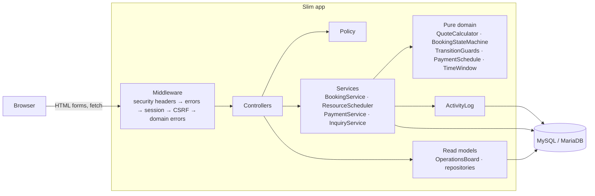
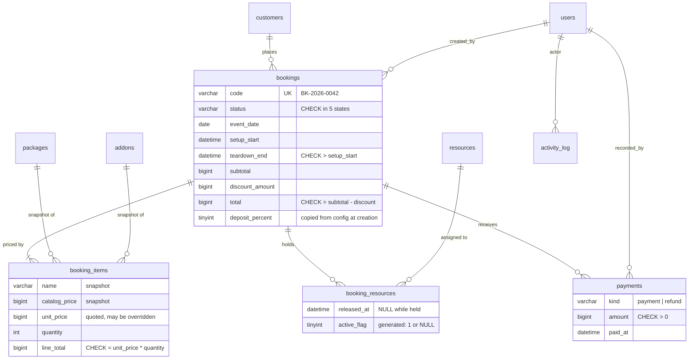

# Event Booking System

Booking and operations system for an event decoration and venue rental business: quotes, resource scheduling with conflict detection, deposits and payment tracking.

[](https://github.com/okaadabi-lab/event-booking-system/actions/workflows/ci.yml)

> Portfolio project. All data in this repository is fictional sample data. "Lentera Decor & Hall" is an invented business.


## The problem

A decoration and venue rental business sells the same halls and crews again and again. Quotes go out on WhatsApp, deposits arrive by bank transfer, and a spreadsheet tracks who is where. The costly mistakes come from that spreadsheet: one hall promised to two families on the same evening, a booking treated as confirmed before the deposit arrived, a quote that changes after a price update, an overdue balance nobody notices until event week.

This application enforces those rules in one place on the server and shows the team what still needs doing.

## Features

- **Public inquiry form** (`/inquiry`, no login). Creates or matches a customer by phone number and opens a booking in `inquiry` status. A honeypot field and a per-IP rate limit filter bots.
- **Quote builder.** Pick a package and add-ons; a vanilla JS preview mirrors the server calculation. Free and busy venues and crews are shown for the setup→teardown window, and ticked resources are reserved in the same transaction as the quote. Quotes cannot be dated in the past.
- **Price snapshots.** Each booking item stores the name, catalog price and quoted unit price. Catalog changes never reprice an existing quote. Owner price overrides are audited.
- **Conflict detection.** A venue or crew cannot hold two bookings whose windows overlap, including a configurable changeover buffer. Cancelling releases the resources.
- **Guarded state machine.** `inquiry → quoted → confirmed → completed`, with `cancelled` reachable from any open state. Confirming requires a paid deposit, at least one resource and no conflicts. Completing is only possible after the event and cancelling needs a reason. A blocked transition names exactly what is missing.
- **Payments.** The deposit (default 30%) gates confirmation and the balance is due N days before the event (default 14). Payments and refunds record method, reference, time and who entered them; a payment date cannot be in the future or more than a year back. Outstanding and overdue amounts are derived, never stored.
- **Finance view.** Receivables aged as overdue, due within 30 days or later, plus a monthly CSV export guarded against spreadsheet formula injection.
- **Resource calendar and activity log.** A month grid of resources × days, and a who/when/before/after record of status changes, payments, overrides and assignments.
- **Roles.** `sales` quotes and schedules, `finance` records payments, `owner` does both and manages the catalog and staff. All rules live in one `Policy` class, and the UI only offers actions the role and booking state allow.

| | |
|---|---|
|  |  |
|  |  |


## Tech stack

| Area | Choice |
|---|---|
| Language | PHP 8.3 (strict types, enums, readonly properties) |
| HTTP | Slim 4 + slim/psr7, manual dependency wiring in `config/container.php` |
| Views | Twig with auto-escaping and `strict_variables` |
| Database | MySQL 8 / MariaDB 10.11, plain numbered SQL migrations |
| Config & logs | vlucas/phpdotenv, Monolog |
| Front end | Hand-written CSS with design tokens, ~220 lines of vanilla JS, self-hosted fonts |
| Quality | PHPUnit 11, PHPStan level 8, PHP_CodeSniffer (PSR-12) |
| CI | GitHub Actions with a MySQL 8 service container |

## Architecture



Controllers are thin: they parse input with `FormInput`/`QuoteForm`, call a service and redirect with a flash message. Services own every write, and each public method is one transaction that locks the booking row, re-checks the rules against fresh data, writes, and appends to the activity log. The pure domain classes have no database access, so totals, deposit rounding, overdue dates and allowed transitions are unit tested directly.

## Database



Money is an integer number of rupiah in `BIGINT` columns; floats never appear in PHP, SQL or JS. Released resource assignments are kept for history, and a generated `active_flag` column with a unique key acts as a partial unique index. Details are in [docs/design-decisions.md](docs/design-decisions.md#database-details).

## Getting started

Requires PHP 8.3 with `pdo_mysql`, `mbstring` and `intl`, Composer, and MySQL 8 or MariaDB 10.11.

```bash
composer install
cp .env.example .env            # then set DB_USERNAME / DB_PASSWORD
mysql -e "CREATE DATABASE event_booking; CREATE DATABASE event_booking_test;"
php bin/migrate                 # applies database/migrations/*.sql
php bin/seed                    # fictional demo data, dated relative to today
php -S 127.0.0.1:8081 -t public
```

Open <http://127.0.0.1:8081/login>. The seeded accounts are `owner@lentera.example.com`, `sales@lentera.example.com` and `finance@lentera.example.com`, all with the password `lentera-demo-2026`.

With Docker, `docker compose up -d --build`, then `docker compose exec app php bin/migrate` and `docker compose exec app php bin/seed`. This starts PHP-FPM, nginx on <http://localhost:8081> and MySQL 8 on host port 3307.

```bash
composer test      # PHPUnit: unit + integration + HTTP (needs the _test database)
composer lint      # PHPCS (PSR-12) + PHPStan level 8
```

The 235 tests include integration tests against real MySQL/MariaDB (a second connection holding the row lock, buffer boundaries) and HTTP tests through the full middleware stack (CSRF, role 403s, login throttling, the quote → payment → confirm flow).

The full endpoint list, every environment variable and the maintenance commands (`bin/migrate --fresh`, `bin/prune`) are in [docs/operations.md](docs/operations.md).

## Design decisions

The short version. [docs/design-decisions.md](docs/design-decisions.md) has the full reasoning, the security controls and the test coverage.

**Double-booking prevention without exclusion constraints.** MySQL has no range exclusion constraint, and check-then-insert races. `ResourceScheduler::assign()` locks the booking row, then the resource row (`SELECT … FOR UPDATE`), runs the overlap query and inserts in one transaction, so every writer for a resource queues on that lock. The connection runs at `READ COMMITTED` so the overlap query sees holds committed while it waited. Locks are always taken booking first, then resources by ascending id, which rules out deadlock cycles.

**Inquiries hold resources too.** Blocking only confirmed bookings would let two quotes for the same evening both reach the deposit stage. Tentative holds are shown hatched on the calendar so sales can release them.

**The deposit gates confirmation.** There is no separate deposit due date; if the deposit is still unpaid when the balance falls due, the whole outstanding amount is overdue. `deposit_percent` is copied onto each booking so a config change does not move the goalposts.

**Server-side totals only.** The browser posts catalog ids, quantities and (for owners) price overrides, never a total. A test posts a tampered `total` to show it is ignored.

**Database sessions.** Storing sessions in the database makes revocation possible: deactivating a user or changing a password deletes their sessions. Session ids are stored as SHA-256 hashes.

**No ORM or DI framework.** The query paths are few and specific. Hand-written SQL in small repositories keeps every query visible and parameterised, and the ~70-line container reads top to bottom.

## Limitations and future work

- **No customer notifications.** Messages on quote, deposit receipt or overdue balance should go through an outbox table so sending is retried outside the request.
- **No quote PDF.** Customers receive the total by message.
- **Exclusive holds only.** Splitting one crew across two small events would need capacity-based scheduling.
- **Trusted proxies.** Behind a load balancer, `RequestContext::ip()` needs a trusted-proxy list before rate limits work per real client.
- **Throttling scope.** Login is limited per email+IP, so one address can still try a few passwords against many accounts.
- **Session lifetime.** Sessions expire after two hours idle but have no absolute maximum age.
- **Window length.** A booking window is capped at 96 hours, enough for an overnight setup but not a week-long exhibition.
- **Housekeeping.** `bin/prune` must be scheduled by the deployment.

## Part of a portfolio

[customer-data-pipeline](https://github.com/okaadabi-lab/customer-data-pipeline) cleans and deduplicates the kind of customer and lead records this app stores. The two share the idea of a customer record but are not connected at runtime.

## License

MIT. See [LICENSE](LICENSE).
